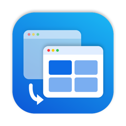
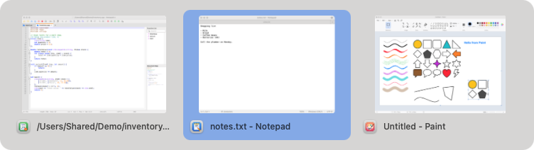
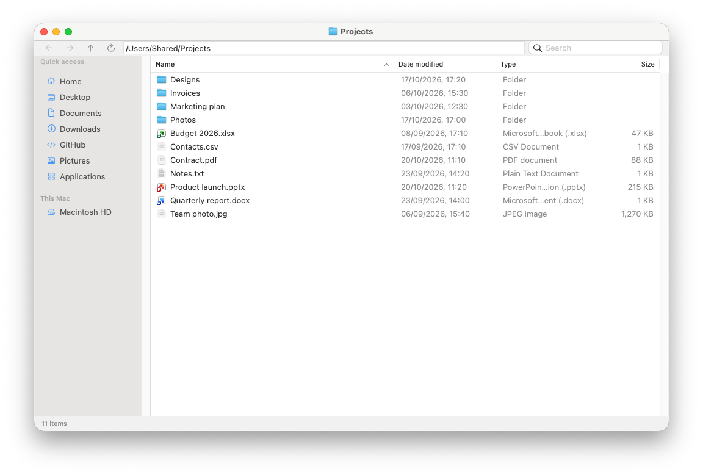
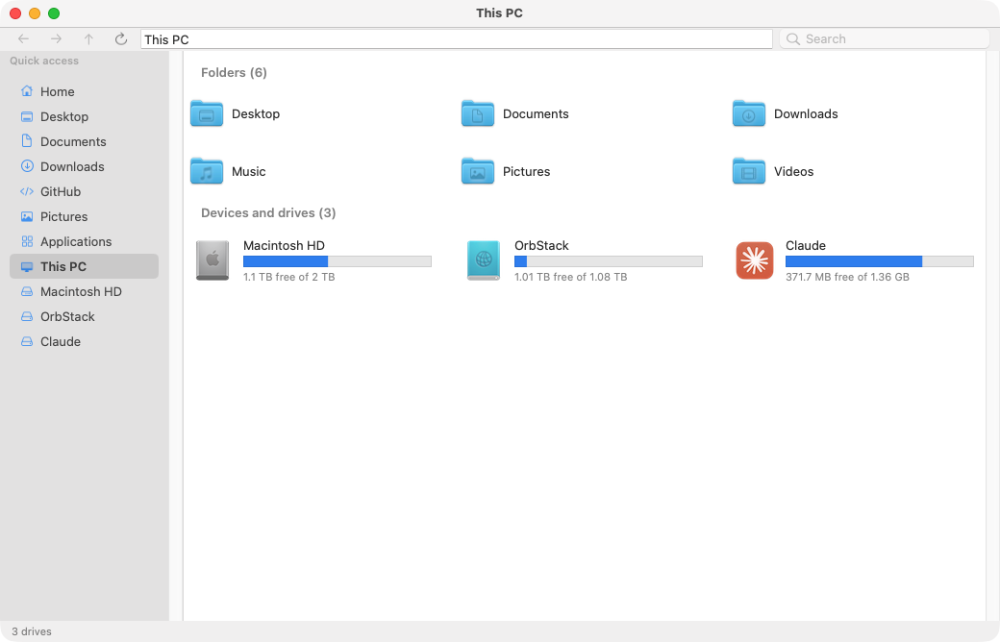
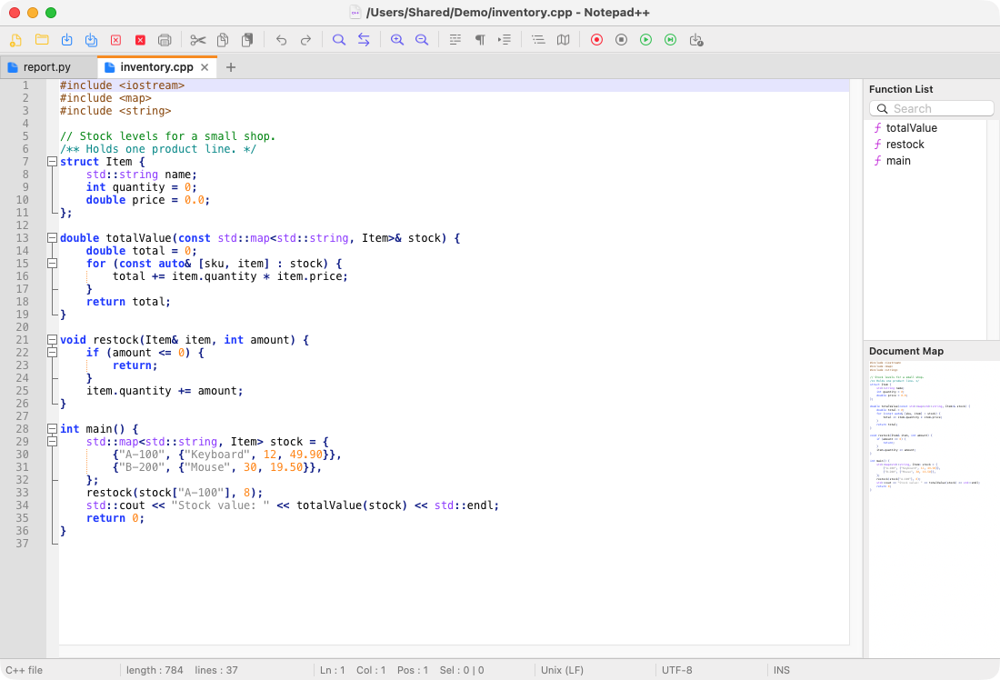
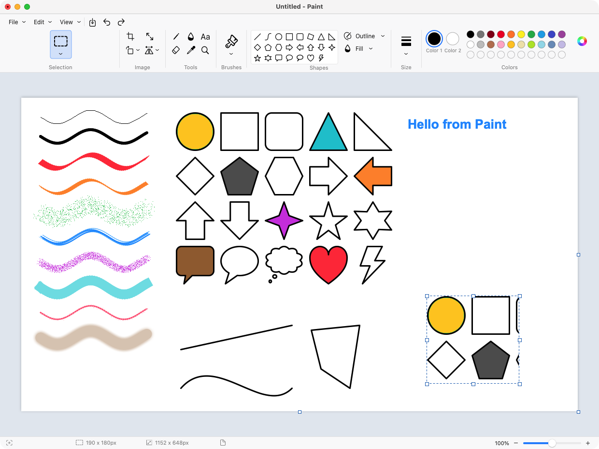
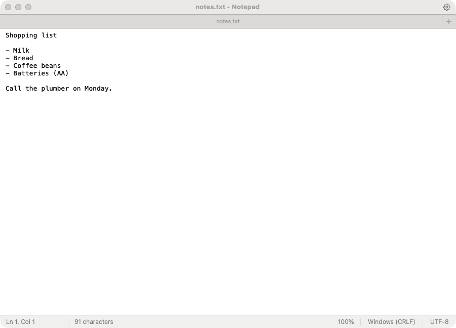

<p align="center"></p>

# WinSwitch

**Make your Mac work like Windows.** WinSwitch is a small menu bar app for people who move between Windows and macOS,
or who use a PC keyboard on a Mac. It brings back the Windows habits your fingers already know: Alt+Tab between
windows, Ctrl+C / Ctrl+V, Home and End, the Win key shortcuts, a Run box, a File Explorer and a Task Manager. One app,
instead of a key remapper, a window switcher, a Dock preview tool and a task manager. It comes with Windows-style
**Notepad**, **Notepad++** and **MS Paint** apps too.

It also knows when to get out of the way: in Remote Desktop (Windows App), Parallels, VMware and other remote
desktops and VMs, every key goes through untouched, so the Windows PC on the other side behaves
exactly as it should.

<p align="center"></p>

## Features

### Alt+Tab, the Windows way
- One thumbnail per **window** (not per app), in most-recently-used order, so a quick Alt+Tab goes back to the
  window you were just in.
- Alt+Shift+Tab or the arrow keys to move back, Esc to cancel, Alt+W or Alt+F4 closes the highlighted window,
  click a thumbnail to jump to it.
- Includes windows on other displays, other desktops (Spaces) and minimized windows.
- A quick Alt+Tab switches without flashing the switcher on screen.

### Dock previews
Hover over a Dock icon to see every window of that app, and click the one you want. Like the Windows taskbar, clicking
the Dock icon itself keeps the previews open, and on the way up to a preview you can cross other Dock icons without
losing it: another app's previews only take over when the mouse rests on its icon. Can be set to appear only while Alt is held, or turned off.

### Windows keys
| Keys | What they do |
|---|---|
| Ctrl+C, V, X, Z, Y, A, S, F, N, T, W, P, O, R... | copy, paste, cut, undo, redo, select all, save, find, new, new tab, close... |
| Home / End | start / end of the line (Shift selects) |
| Ctrl+Home / Ctrl+End | top / bottom of the document |
| Ctrl+Left / Ctrl+Right | jump a word (Shift selects) |
| Ctrl+Backspace / Ctrl+Delete | delete a word |
| Alt+F4 | quit the app (in WinSwitch's own windows it closes the window) |
| Ctrl+Shift+Esc | Task Manager |
| PrtSc / Alt+PrtSc | the screen you're on / the active window to the clipboard |
| Win+Shift+S | snip a region to the clipboard |
| F5, Ctrl+F5 | refresh, hard refresh (browsers) |
| F12, Ctrl+Shift+I | developer tools (browsers) |
| F2, F3 | rename, search (Finder); F3 / Shift+F3 find next / previous elsewhere |
| F6, F11, Ctrl+F4 | address bar, full screen, close tab |
| Alt+Shift | next keyboard language (Alt+Shift+Tab still switches windows backwards) |
| Ctrl+Alt+Win+K | turn all of the above off and on |

In terminals (Terminal, iTerm2, Ghostty, Warp, kitty, Alacritty, WezTerm) the keys follow Windows Terminal instead:
Ctrl+C copies when text is selected and interrupts otherwise, Ctrl+Shift+C copies, Ctrl+V pastes. Apps that give
F keys their own meaning (VS Code, Xcode, JetBrains IDEs, Office) keep them.

### Win key
The Win key of a PC keyboard gets the Windows shortcuts, while Cmd on the Mac's own keyboard keeps working as Cmd:

| Keys | What they do |
|---|---|
| Win+V (or Win+C) | clipboard history |
| Win+R | Run box |
| Win+E | File Explorer |
| Win+D | show the desktop, press again to bring the windows back |
| Win+L | lock the screen |
| Win+Space | next keyboard language |
| Win+PrtSc | save a screenshot |
| Win alone | open the app launcher, like the Start menu |

### Clipboard history (Win+V)
Like the Windows 11 clipboard: WinSwitch remembers the last 25 things you copied (text, images, files). Win+V (or
Win+C) opens the panel next to the mouse, with the newest item on top. Click an item, or pick it with the arrow keys
and Enter, to paste it into the app you were in; Delete removes the selected item and Esc closes the panel.

Each item is a card with a pin and a **...** menu (Delete, Pin / Unpin, Clear all) in its top right corner. Pinned
items stay at the top, don't count toward the 25, and survive **Clear all** and restarts; the rest are forgotten when
WinSwitch quits, as on Windows. The emoji and Ω tabs open the macOS emoji and symbols picker. Copies that password
managers mark as secret are never recorded. Turn it off with "Remember clipboard history" in the menu.

### Run box (Win+R)
Type a program (`notepad`, `calc`, `chrome`), a file or folder (backslashes and `%USERPROFILE%` work), a web address,
`cmd` or `terminal [folder]`, or any command-line program, and press Enter. Keeps a history like Windows.

### File Explorer (Win+E)
An Explorer-style window: an address bar you can paste any path into, Back / Forward / Up, Quick access and drives in
the sidebar, a details list (Name, Date modified, Type, Size) you can sort, search as you type, tabs, cut / copy /
paste of files, F2 rename, Delete to the Trash, drag and drop, Ctrl+click to add or remove one item from the selection
(Shift+click for a range), and a right-click menu with Share (AirDrop, Mail, Messages...), Copy as path, Open in
Terminal and Properties. **This PC** (in the sidebar, by going Up from the top of a disk, or by typing it in the address bar) shows your
folders and every disk with a capacity bar and its free space. **Properties** (Alt+Enter or right-click) shows a file's or
folder's size, contents and dates, with Read-only and Hidden, and a disk's used and free space with a pie chart.
Large copies run in the background with a progress window and Cancel. Files copied in a Remote Desktop
session can be pasted too; macOS keeps them in the Remote Desktop app's own storage, so this needs Full Disk Access.

<p align="center"></p>
<p align="center"></p>

### Task Manager (Ctrl+Shift+Esc)
A Windows-style Task Manager, also in the menu bar menu and as `taskmgr` in the Run box:
- **Processes**: apps, background processes and macOS processes, each app grouped with its helper processes, with
  CPU, memory and disk use shaded like Windows. End task (Delete), Switch to, Open file location, Search online.
  Apps that hang show as "Not responding".
- **Performance**: 60-second graphs for CPU (overall or each logical processor), memory (with its composition),
  every disk, network adapter and the GPU.
- **Startup apps**: login items and launch agents / daemons with their publisher; Enable / Disable.
- **Users**, **Details** (every process with PID, user, threads, architecture and priority; End process tree,
  Suspend / Resume, Set priority) and **Services** (launchd services; Start / Stop / Restart).
- Search by name or PID, sortable columns, Always on top and the update speed (High, Normal, Low, Paused) in Settings.

Processes of other users and macOS can be ended after an administrator password, like "Run as administrator".

### Notepad, Notepad++ and MS Paint
Three separate apps come with WinSwitch, built and installed next to it as **Notepad**, **Notepad++** and
**MS Paint**. The Run box opens them as `notepad`, `notepad++` (or `npp`) and `mspaint`, and they appear in Finder's
Open With for text and image files. Their Save As is the Windows dialog: a navigation pane, an address bar you can
type in, and a File name box that also takes a full path (`~/notes/todo.txt`, `/tmp/a.txt`, backslashes work too).

- **Notepad** works like the Windows 11 Notepad. It has tabs, Find and Replace (Ctrl+H), Go to (Ctrl+G), Time/Date (F5),
  Word wrap, zoom, and a status bar with line ending and encoding (UTF-8, UTF-8 with BOM, UTF-16, ANSI). Open tabs and
  unsaved text come back on the next start.
- **Notepad++** works like Notepad++ for Windows, on [Scintilla](https://www.scintilla.org), the same editing component:
  - It highlights more than 60 languages and folds code. It has bookmarks (Ctrl+F2, F2), smart highlighting and
    word completion, plus multi-caret and column editing (Alt+drag, Column Editor with Alt+C).
  - Find / Replace / Find in Files / Mark work with normal, extended and regular-expression modes. Results go to a
    Search results panel.
  - It also has a Function List, a Document Map and macros (record, play back, run many times, save).
  - Line operations include sort, remove duplicates, join and split. Case conversion, comments (Ctrl+Q), EOL and
    encoding conversion, the Run menu and Notepad++'s menus are there too. A session snapshot keeps unsaved tabs.
- **MS Paint** works like the Windows 11 Paint:
  - Tools: pencil, fill, text, eraser, color picker and magnifier, 9 brushes, and 23 shapes that stay editable
    until committed.
  - Selections can be rectangle or free-form, transparent, cut, copied, pasted or cropped. Images can be rotated,
    flipped, resized and skewed.
  - Zoom goes from 12.5% to 800% with gridlines and rulers. Files save as PNG, JPEG, BMP, GIF, TIFF or HEIC.
  - Set as desktop background and Image properties are there as well.

<p align="center"></p>
<p align="center"></p>
<p align="center"></p>

### Mouse wheel
A wheel mouse scrolls the Windows way round (in Remote Desktop and VMs too) while the trackpad keeps the Mac's natural scrolling. (macOS has a single
setting for both.)

## Download

Get the latest **WinSwitch.dmg** from [Releases](https://github.com/kamrat11/WinSwitch/releases/latest), open it and
drag WinSwitch (and Notepad, Notepad++ and MS Paint if you want them) to Applications. They are signed and notarized
by Apple. Then allow the [permissions](#permissions).

## Getting started (build from source)

### 1. What you need
- A Mac with **macOS 15 (Sequoia) or later**, Apple silicon or Intel.
- The **Swift 6 compiler**. Either install [Xcode](https://apps.apple.com/app/xcode/id497799835) 16 or later
  from the App Store, or just the Command Line Tools (much smaller):
  ```
  xcode-select --install
  ```
  Check it with `swift --version` (it should say Swift 6.0 or later).
- `git`, which comes with the Command Line Tools.

### 2. Get the code
```
git clone https://github.com/kamrat11/WinSwitch.git
cd WinSwitch
```

### 3. Compile and run
```
./build.sh --install
```
This compiles a release build (`swift build -c release`), packs it into `build/WinSwitch.app`, signs it, copies it to
`~/Applications/WinSwitch.app` and starts it. Notepad, Notepad++ and MS Paint are built and installed to `~/Applications`
the same way. The first build takes about a minute; later ones a few seconds.
A WinSwitch icon (two overlapping windows) appears in the menu bar. There is no Dock icon.

Other ways to build:

| Command | What it does |
|---|---|
| `./build.sh` | compile and pack all four apps into `build/` (WinSwitch, Notepad, Notepad++, MS Paint), without installing or starting them |
| `./build.sh --install WinCode` | build and install only the apps named, by target: `WinSwitch`, `WinPad` (Notepad), `WinCode` (Notepad++), `WinPaint` (MS Paint) |
| `open build/WinSwitch.app` | run that build in place |
| `swift build` | debug compile only, to check the code builds (the result is a bare binary, not an app, and can't get the permissions) |

To update later: `git pull` and run `./build.sh --install` again. It quits the running copy first.

### 4. Allow the permissions
On first launch macOS asks for the permissions WinSwitch needs. Allow them as described in
[Permissions](#permissions) below. WinSwitch starts working on its own a few seconds after Accessibility is allowed;
no restart is needed.

### 5. Start at login
Click the menu bar icon and turn on **Start at login**.

### Signing (optional)
macOS ties the permissions to the app's signature. Without a certificate the app is signed ad hoc, and every
rebuild looks like a new app, so macOS asks for the permissions again. To avoid that, sign with your own
certificate: any free "Apple Development" certificate from Xcode works. Find its name with
```
security find-identity -v -p codesigning
```
and put it (for example `Apple Development: you@example.com (ABCDE12345)`) in a `.sign-identity` file in the project
folder, or in the `WINSWITCH_SIGN_IDENTITY` environment variable. `.sign-identity` is never committed.

### Making a release (optional)
`tools/release.sh` builds a signed and notarized `build/WinSwitch-<version>.dmg` that opens on any Mac, and
`tools/release.sh --publish` also attaches it to a GitHub release. It needs a "Developer ID Application" certificate
(named in `.release-identity` or `WINSWITCH_RELEASE_IDENTITY`), an App Store Connect API key for notarization (a JSON
file with `keyId`, `issuerId` and `keyPath`, in `WINSWITCH_NOTARY_CONFIG`) and, for `--publish`, the `gh` tool. The
version comes from `CFBundleShortVersionString` in `Resources/Info.plist`.

### Troubleshooting
- **Nothing happens after a rebuild**: an ad hoc build lost its permissions; see
  [Permissions after a rebuild](#permissions-after-a-rebuild).
- **Win key shortcuts don't work**: allow Input Monitoring, and make sure Karabiner-Elements is not running.
- **No thumbnails in Alt+Tab**: allow Screen Recording.
- **Uninstall**: quit WinSwitch from its menu and delete `~/Applications/WinSwitch.app`.

### Options
- Every keyboard counts as a PC keyboard unless it is made by Apple. To use only one keyboard:
  `defaults write com.kamrat.WinSwitch windowsKeyboardVendor -int <vendor id>` (and `windowsKeyboardProduct`).
- Remote desktop and VM apps that get keys untouched are in `passthroughBundlePrefixes`.
- To keep apps out of Alt+Tab and the Dock previews:
  `defaults write com.kamrat.WinSwitch excludedBundleIds -array com.apple.Music com.apple.Terminal`.
- Don't run Karabiner-Elements at the same time: it takes exclusive control of the keyboards.

## Permissions

macOS protects keyboard input, other apps' windows and the screen, so WinSwitch needs your permission for each. All
of them are in **System Settings > Privacy & Security**, and the WinSwitch menu bar icon has a shortcut to each page.
WinSwitch works entirely on your Mac and sends nothing over the network. The only thing it saves is the clipboard items you pin, in `~/Library/Application Support/WinSwitch`.

| Permission | Why WinSwitch needs it | Without it |
|---|---|---|
| **Accessibility** (required) | to see and change key presses, read the Dock, and move, raise and close windows | nothing works |
| **Input Monitoring** | to tell the Win key of a PC keyboard apart from Cmd on a Mac keyboard | Win+R, Win+E, Win+D, Win+L and "Win alone" don't work; everything else does |
| **Screen Recording** | to draw window thumbnails in Alt+Tab and the Dock previews, and for PrtSc and Alt+PrtSc | Alt+Tab and Dock previews show app icons instead of thumbnails |
| **Automation: System Events** (asked the first time) | for the Task Manager's Startup apps page to list and change login items | login items are missing from Startup apps |
| **Automation: Terminal** (asked the first time) | for the Run box to open Terminal and run `cmd`, `terminal` or command-line programs | those Run box commands can't open Terminal |
| **Full Disk Access** (recommended; offered the first time the File Explorer opens, or from the menu bar item) | for the File Explorer to open every folder without asking for each one | macOS asks separately for Desktop, Documents, Downloads, iCloud Drive and removable drives, and protected folders such as Mail or Safari look empty |

### How to allow a permission
1. Open **System Settings > Privacy & Security** and click the permission (for example **Accessibility**), or use
   the shortcut in the WinSwitch menu.
2. Turn on the switch next to **WinSwitch**. macOS asks for your password or Touch ID.
3. If WinSwitch is not in the list, click **+**, press **Cmd+Shift+G**, paste `~/Applications/WinSwitch.app` and
   click **Open**.

macOS may say Screen Recording or Input Monitoring only take effect after WinSwitch restarts; choose
**Quit & Reopen**, or start WinSwitch again from `~/Applications`. Automation is asked for in a dialog the first time
the Run box opens Terminal; click **Allow**. If you clicked **Don't Allow**, turn it on under
**Privacy & Security > Automation > WinSwitch > Terminal**.

### Permissions after a rebuild
macOS ties permissions to the app's signature. An ad hoc signed build (the default without a certificate, see
[Signing](#signing-optional)) counts as a new app every time, so the switches stay on but no longer apply. Remove
WinSwitch from each list with **-** and add it again, or reset them all at once and start WinSwitch again:
```
tccutil reset All com.kamrat.WinSwitch
```

## Limitations
- Keys are changed by an event tap, so like any app-level remapper it does not act inside password fields (macOS
  secure input).
- WinSwitch uses private macOS APIs (as AltTab does) to bring windows to the front, so it cannot be sold through the
  Mac App Store.

## Credits
The window techniques (Dock accessibility, `_AXUIElementGetWindow`, SkyLight focus, ScreenCaptureKit thumbnails)
follow what [AltTab](https://github.com/lwouis/alt-tab-macos) and [DockDoor](https://github.com/ejbills/DockDoor) do.
Notepad++ for Mac is built on [Scintilla and Lexilla](https://www.scintilla.org) by Neil Hodgson, included unmodified in
`Vendor/Scintilla` under their own license (`Vendor/Scintilla/License.txt`).

## License
[GPL-3.0](LICENSE)
